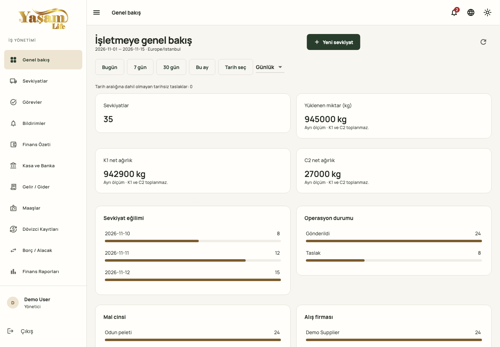
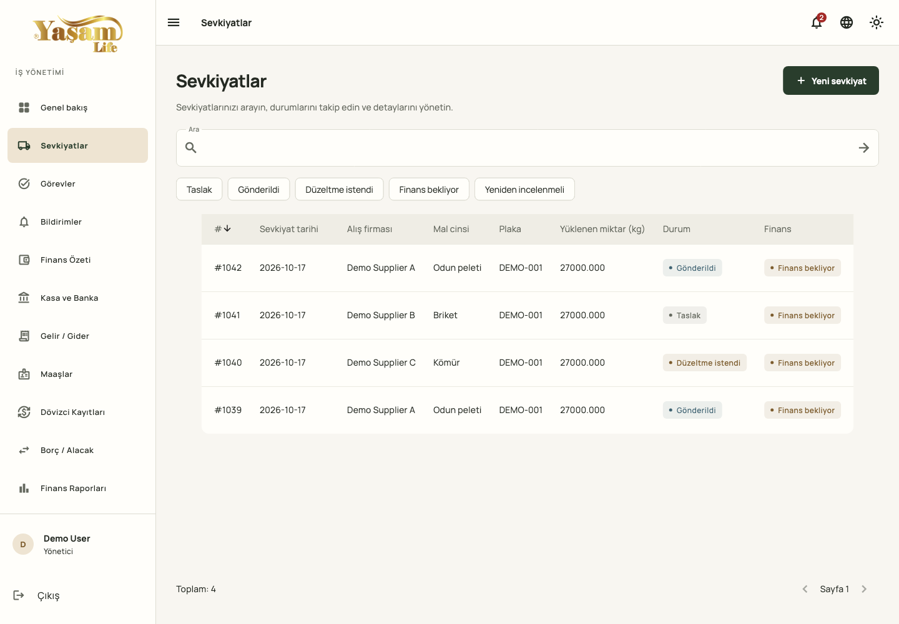
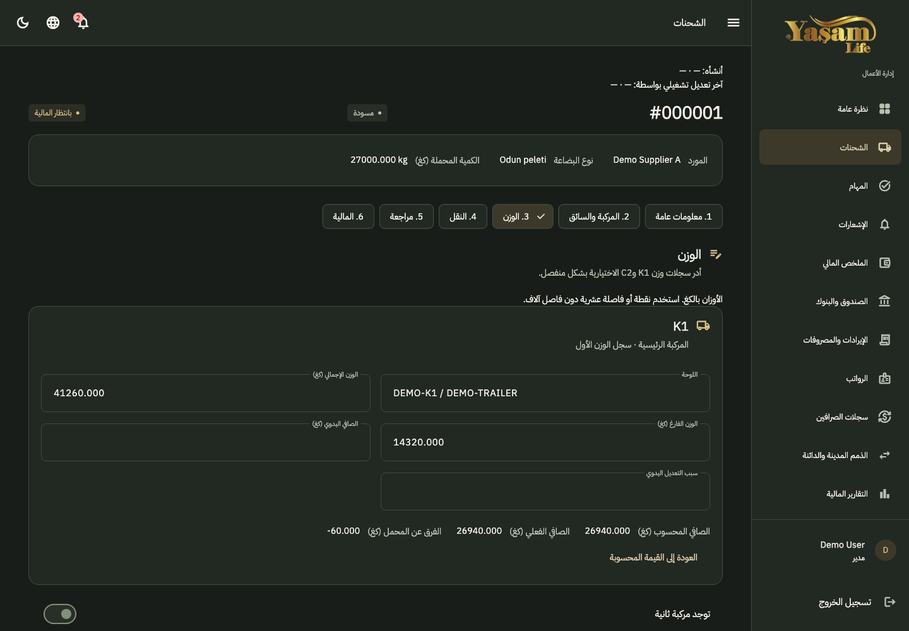
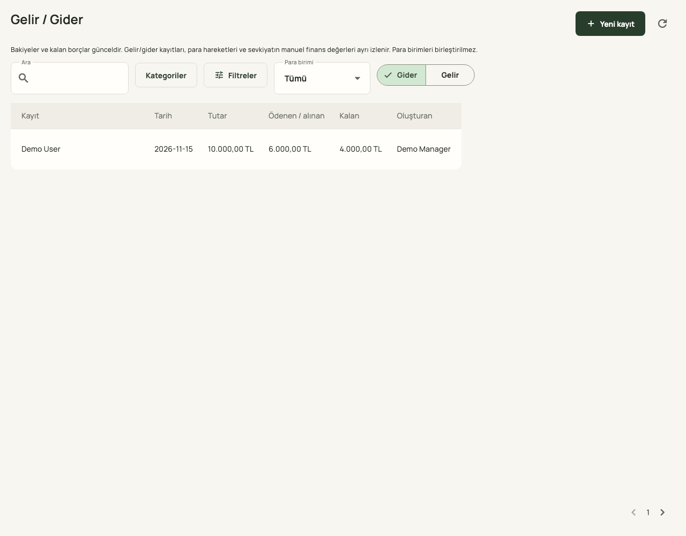

# YaşamLife ERP system — عرض المشروع

<a href="README.md">English</a> · <a href="README.tr.md">Türkçe</a> · <a href="README.ar.md">العربية</a>

**مشروع لعميل · AZİZ TÜRKMEN · أكتوبر–نوفمبر 2026، وفق الأشهر التي حددها صاحب المشروع. لم يُوثّق اليوم الدقيق للإطلاق أو الإنجاز.**

نظام ERP يركز على سطح المكتب ويجمع عمليات الشحن ووزن K1/C2 ومهام الفريق والمحاسبة الإدارية بواجهتين تركية وعربية.

قيد التشغيل الفعلي وفق إفادة صاحب المشروع؛ يختلف توفر الإصدارات باختلاف المنصة.

*S01 — نظرة عامة مكتبية تعرض الحمولة وقياسي K1 وC2 بصورة مستقلة؛ بيانات تجريبية.*

تستخدم صور العمليات بيانات تجريبية مصطنعة داخل واجهة Flutter الحقيقية. ليست سجلات إنتاج أو نتائج أعمال أو لقطات من أجهزة فعلية. أما صورة الدخول فمن الصفحة العامة الفعلية بحقول فارغة.

## منظور العميل

إتاحة الشحنة نفسها للفريق مع الحفاظ على مسؤولية التعديل وخصوصية المالية، والتمييز بين قياس الوزن والالتزام المالي والدفع الفعلي.

مساحة عمل مشتركة مبنية بـ Flutter، بصلاحيات وحالات واضحة للسجلات، ونموذج يفصل الذمم عن تسوياتها. تدعم الواجهتان التركية والعربية مسارات العمل التشغيلية نفسها.

- سياق مشترك للشحنات — ابحث عن السجلات نفسها مع وضوح الحالة والمسؤولية، مع بقاء حدود تعديل الموظفين.
- مراحل وزن مستقلة — تابع الحمولة المسجلة وصافي K1 وصافي C2 الاختياري بصورة منفصلة، مع إظهار الفروق والتعديلات الصريحة.
- تنسيق عمل الفريق — أسند المهام وتابع تقدمها وناقش العمل المرتبط بالشحنات عبر التعليقات والإشعارات الداخلية.
- فصل الذمم عن المدفوعات — سجل الإيراد أو المصروف أو الراتب مرة واحدة، ثم تابع التسويات الجزئية والمبلغ المتبقي.
- أرصدة مستقلة لكل عملة — راجع الحسابات وأرصدة الصرافين بحسب العملة؛ ويظل كل طرف من اتفاق الصرف مستقلاً.
- تجربة تركية وعربية — استخدم التطبيق بالتركية أو العربية، مع ترتيب من اليمين إلى اليسار ومظهر فاتح أو داكن.

### سير العمل

1. أنشئ مسودة شحنة وحدد الحمولة والمركبة.
2. أدخل قياسات K1 وC2 عند الحاجة، ثم احفظ وأرسل السجل.
3. تابع العمل بالمهام والتعليقات والتصحيحات المسموح بها.
4. راجع مالية الشحنة الخاصة وسجل الذمم المحاسبية بصورة مستقلة.
5. سجل التسوية وراجع المتبقي وصحح الأخطاء بقيود عكسية تحفظ التاريخ.

## مشاهد من التطبيق

*S02 — قائمة الشحنات المشتركة مع البحث والحالات وموردين افتراضيين.*

*S03 — نموذج وزن عربي من اليمين إلى اليسار يعرض الإجمالي والفارغ والصافي بأرقام مركبات تجريبية.*

*S05 — واجهة الإيرادات والمصروفات تعرض المبلغ والمدفوع والمتبقي؛ لا تتضمن سجلات مالية حقيقية.*

- [قائمة مهام بأولويات ومواعيد وحالات تقدم تجريبية.](screenshots/app-tasks-desktop-tr-light.png)
- [عرض الذمم المدينة والدائنة بأرصدة تسوية تجريبية.](screenshots/app-obligations-desktop-tr-light.png)
- [عرض عربي ضيق للشحنات ضمن اختبار Flutter؛ ليس لقطة من هاتف فعلي.](screenshots/app-shipments-narrow-ar-dark.png)
- [شاشة تسجيل الدخول الفعلية والحقول فارغة؛ لم تُدخل بيانات دخول.](screenshots/web-login-desktop-tr-dark.jpg)

## المنصات وحالة التوزيع

التجربة الأساسية مكتبية. توجد مشروعات لـ Windows وmacOS، ويشترك Android وiOS في قاعدة Flutter. يمكن الوصول إلى مدخل الويب عبر الصفحة التعريفية. تذكر تقارير سابقة نجاح بناء نسخ تجريبية ومحاكيات، لكن هذه المراجعة لم تثبت إصداراً موقّعاً أو صفحة متجر. وفي 15 نوفمبر 2026 أفادت الصفحة الفعلية بأن ملف Windows ZIP لم يُنشر بعد. يبقى Microsoft Store وApp Store وGoogle Play ضمن خطط التوزيع. شاشات الإدارة جزء من التطبيق المشترك وليست تطبيقاً إدارياً منفصلاً منشوراً.

## الجانب الهندسي

يوفر Flutter وDart الواجهة المشتركة، مع Riverpod وGoRouter واتصال HTTP. ويستخدم الخادم PHP وتخزيناً علائقياً متوافقاً مع MySQL. تعكس التعديلات الذرية للشحنات والحسابات العشرية الدقيقة وحالات المراجعة الصريحة والتصحيحات المالية العكسية طبيعة العمل. تساعد معالجة إعادة المحاولة على تجنب تكرار العملية المحاسبية نفسها. هذه قرارات تنفيذ تمت مراجعتها، وليست شهادة أمنية أو ضماناً لسعة غير محدودة أو إثباتاً لكل مسار في الإنتاج.

## اللغات وتجربة الاستخدام

يدعم التطبيق التركية والعربية، والاتجاه من اليمين إلى اليسار، والمظهر الفاتح والداكن ومظهر النظام، والتكيف بين سطح المكتب والشاشات الضيقة. أما لغات هذا العرض فهي الإنجليزية والتركية والعربية. الإنجليزية ليست لغة منفذة داخل التطبيق، واختبارات التنسيق لا تعني اعتماد إمكانية الوصول أو قبول الأجهزة الفعلية بالكامل.

## بيانات المشروع

مشروع لعميل يُعرض من خلال Ideabat. يشمل نطاق التسليم الذي تمت مراجعته التطبيق وواجهة API ونموذج البيانات والصفحة التعريفية. لم تُوثّق بصورة مستقلة مسؤوليات كل فرد في الفريق أو توزيع حقوق الملكية الفكرية تعاقدياً؛ ولا يُدّعى التأليف الحصري أو ملكية المنتج.

المخرج المثبت هو مجموعة منفذة من قدرات التشغيل والمحاسبة الأساسية. أفاد صاحب المشروع بأن المنتج قيد التشغيل الفعلي. لا تتوفر نتائج أعمال مقاسة أو أعداد استخدام أو دراسة قبل/بعد أو شهادة من العميل.

يدعم التطبيق التركية والعربية، ولا يتضمن واجهة إنجليزية منفذة. لا يشمل نطاق التسليم المثبت حساب الأرباح تلقائياً أو رفع المستندات أو الربط المصرفي أو أسعار الصرف المباشرة أو الرواتب النظامية أو مشاركة الملفات على الهاتف. لم يُتحقق من إصدار أصلي موقّع أو منشور في المتاجر. وكانت صفحة الموقع في 15 نوفمبر 2026 تفيد بأن ملف Windows ZIP لم يُنشر بعد.

## رابط المشروع الرسمي

[استكشف YaşamLife](https://app.yasamlife.com/) — تم التحقق من الصفحة التعريفية في 15 نوفمبر 2026. راجعها لمعرفة توفر التنزيل فعلياً.

## صفحات Ideabat المخططة

**صفحة المشروع — مخطط — لم يُنشر بعد**

<a href="https://ideabat.com/portfolio/yasamlife-erp/">English</a> · <a href="https://ideabat.com/tr/portfolio/yasamlife-erp/">Türkçe</a> · <a href="https://ideabat.com/ar/portfolio/yasamlife-erp/">العربية</a>

**دراسة الحالة — مخطط — لم يُنشر بعد**

<a href="https://ideabat.com/case-study/yasamlife-shipment-accounting-workflows/">English</a> · <a href="https://ideabat.com/tr/case-study/yasamlife-shipment-accounting-workflows/">Türkçe</a> · <a href="https://ideabat.com/ar/case-study/yasamlife-shipment-accounting-workflows/">العربية</a>

## الملكية والمراجعة التقنية

يحتوي هذا المستودع على توثيق ومواد بصرية ضمن إذن النشر، وليس إصداراً للشفرة المصدرية للتطبيق. عرض المشروع عبر Ideabat لا ينقل ملكية العميل. للاستفسارات المتعلقة بالتوظيف أو التعاون أو المراجعة التقنية، يُرجى التواصل مع Ragıp Mullamusa عبر Ideabat. يتطلب الوصول إلى الشفرة المملوكة للعميل إذناً مسبقاً من صاحب المشروع والالتزام بمتطلبات السرية المعمول بها. تُراجع الطلبات كل على حدة، ولا يُضمن الوصول إلى المصدر. لا يمنح هذا العرض أي ترخيص برمجي أو إذن بإعادة التوزيع.

Ragıp Mullamusa هو مؤسس [Ideabat](https://ideabat.com/). للاستفسارات ذات الصلة بالهندسة أو التوظيف أو التعاون، يُرجى استخدام [صفحة التواصل](https://ideabat.com/contact-us/) أو المراسلة على [info@ideabat.com](mailto:info@ideabat.com).

