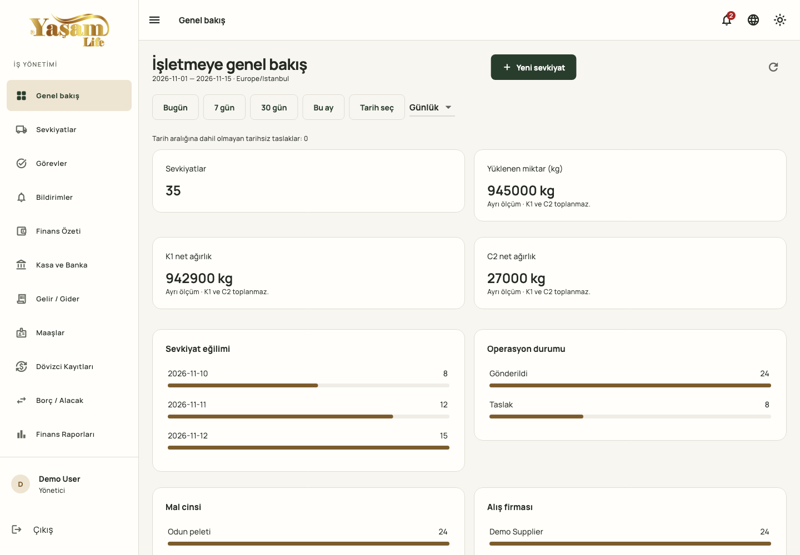
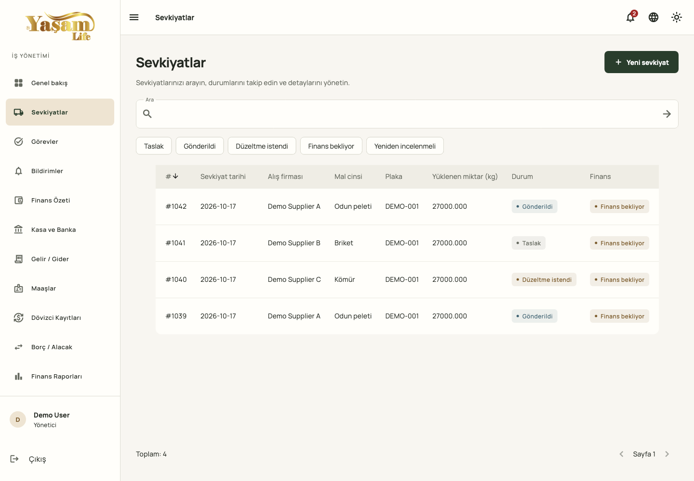
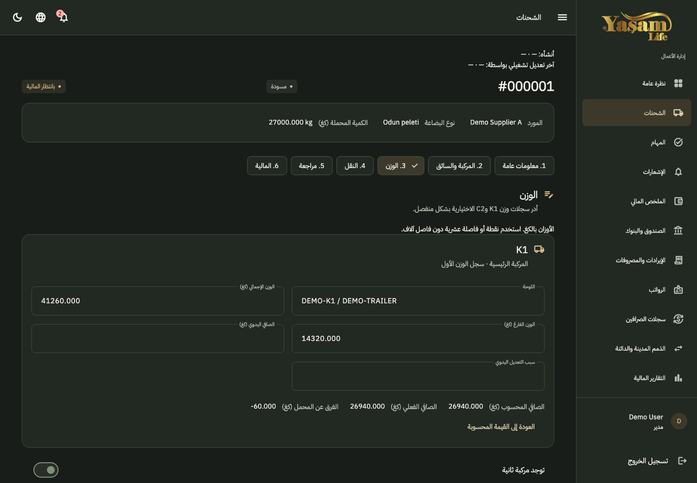
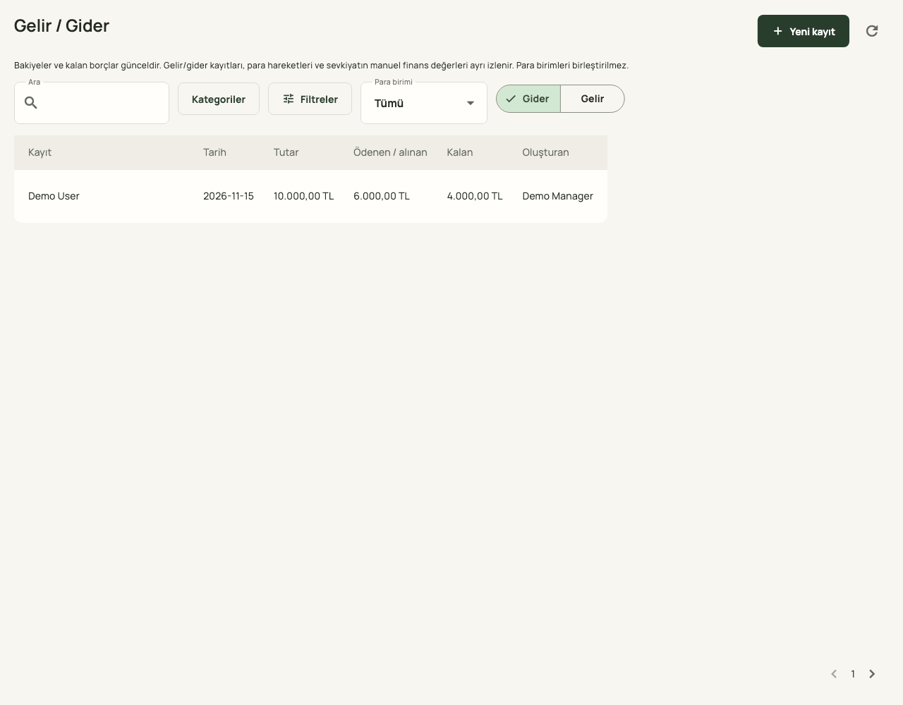

# YaşamLife ERP system — Project Showcase

[English](README.md) · [Türkçe](README.tr.md) · [العربية](README.ar.md)

**Client project · AZİZ TÜRKMEN · October–November 2026; month-level dates supplied by the owner. Exact launch and completion days are not documented.**

A desktop-focused ERP workspace connecting shipment operations, K1/C2 weighing, team tasks and manager accounting in Turkish and Arabic.

LIVE, as reported by the project owner; release availability varies by platform.

*S01 — Desktop overview with independent load, K1 and C2 measures; synthetic data.*

All operational screenshots use synthetic demonstration data rendered by the real Flutter UI. They are not production records, business results or native-device captures. The sign-in screenshot is a live public page with empty fields.

## Customer view

Keep the same shipment visible to the team while preserving editing responsibility, private finance and the distinction between a weight measurement, an obligation and an actual payment.

A shared Flutter workspace with role-controlled workflows, explicit shipment states and a separate obligation/payment model. Turkish and Arabic layouts support the same operational journeys.

- Shared shipment context — Find shipments in one searchable workspace, with status and responsibility visible. Staff edit limits remain in place.
- Independent weighing stages — Keep recorded load, K1 net and optional C2 net separate, with explicit net overrides and differences.
- Team coordination — Assign tasks, follow progress and discuss shipment-related work through comments and in-app notices.
- Obligations and payments — Record income, expenses and salaries once, then follow partial settlements and remaining balances.
- Currency-specific positions — Review account and dealer balances by currency; exchange agreements keep each negotiated leg independent.
- Turkish and Arabic experience — Use the same app in Turkish or Arabic, including RTL layout and light/dark themes.

### Workflow

1. Prepare a shipment draft and identify the load and vehicle.
2. Enter K1 and optional C2 measurements; save and submit.
3. Coordinate follow-up through tasks, comments and controlled corrections.
4. Review private shipment finance and account for obligations separately.
5. Record settlements, inspect the remaining amount and reverse mistakes with history preserved.

## Application views

*S02 — Shared shipment list with search, statuses and fictional suppliers.*

*S03 — Arabic RTL weighing form with gross, tare and net; fictional vehicle identifiers.*

*S05 — Income/expense UI showing sample amount, paid and remaining columns; no real financial records.*

- [Task list with sample priorities, due dates and progress states.](screenshots/app-tasks-desktop-tr-light.png)
- [Outstanding-obligation view with synthetic settlement balances.](screenshots/app-obligations-desktop-tr-light.png)
- [Narrow Arabic shipment view rendered by Flutter tests; not a mobile-device capture.](screenshots/app-shipments-narrow-ar-dark.png)
- [Live blank sign-in screen; no credentials entered.](screenshots/web-login-desktop-tr-dark.jpg)

## Platforms and release status

Desktop is the primary experience. Windows and macOS target projects are present; Android and iOS share the Flutter codebase. A web entry is accessible through the landing page. Earlier reports record native debug/simulator builds, but no signed release or store listing was verified in this review. On 15 November 2026 the live landing page stated that the Windows ZIP was not yet published. Microsoft Store, App Store and Google Play are future distribution plans. There is no separately released admin application: management screens are part of the shared app.

## Engineering view

Flutter/Dart supplies the shared interface, with Riverpod, GoRouter and HTTP. The backend uses PHP and MySQL-compatible relational storage. Atomic shipment editing, exact decimal arithmetic, explicit review states and reversal-based financial corrections reflect the domain. Retry handling supports repeat submissions without intentionally duplicating an accounting action. These are reviewed implementation choices, not security certification, unlimited scale or proof of every production workflow.

## Languages and experience

The app supports Turkish and Arabic, including RTL, light/dark/system themes and responsive desktop/narrow layouts. English, Turkish and Arabic are the languages of this showcase. English is not an implemented app locale. Layout tests are not a claim of full accessibility or physical-device acceptance.

## Project facts

Client project presented through Ideabat. The reviewed delivery includes the app, API, data model and supporting landing page. Individual team responsibilities and contractual IP allocation are not independently documented; no exclusive authorship or ownership claim is made.

The verified outcome is an implemented set of operational and basic-accounting capabilities. The owner reports the product LIVE. No measured business improvement, adoption figure, before/after study or testimonial is available.

The app supports Turkish and Arabic, not English. Profit automation, receipt uploads, bank/live-FX integration, statutory payroll and mobile file sharing are outside the verified delivered scope. No signed native or store release was verified. The Windows ZIP was unavailable on the live landing page on 15 November 2026.

## Official project link

[Explore YaşamLife](https://app.yasamlife.com/) — landing page verified live on 2026-11-15. Check this page for actual download availability.

## Planned Ideabat pages

**Portfolio — planned — not yet published**

[English](https://ideabat.com/portfolio/yasamlife-erp/) · [Türkçe](https://ideabat.com/tr/portfolio/yasamlife-erp/) · [العربية](https://ideabat.com/ar/portfolio/yasamlife-erp/)

**Case study — planned — not yet published**

[English](https://ideabat.com/case-study/yasamlife-shipment-accounting-workflows/) · [Türkçe](https://ideabat.com/tr/case-study/yasamlife-shipment-accounting-workflows/) · [العربية](https://ideabat.com/ar/case-study/yasamlife-shipment-accounting-workflows/)

## Ownership and technical review

This repository contains documentation and approved visual material, not an application source release. Presentation through Ideabat does not transfer a client's ownership. For employment, collaboration or technical-review inquiries, contact Ragıp Mullamusa through Ideabat. Access to client-owned source requires prior permission from the project owner and compliance with applicable confidentiality requirements. Requests are reviewed individually; source access is not guaranteed. No software license or redistribution permission is granted by this showcase.

Ragıp Mullamusa is the founder of [Ideabat](https://ideabat.com/). For relevant engineering, employment or collaboration inquiries, use [the contact page](https://ideabat.com/contact-us/) or [info@ideabat.com](mailto:info@ideabat.com).
