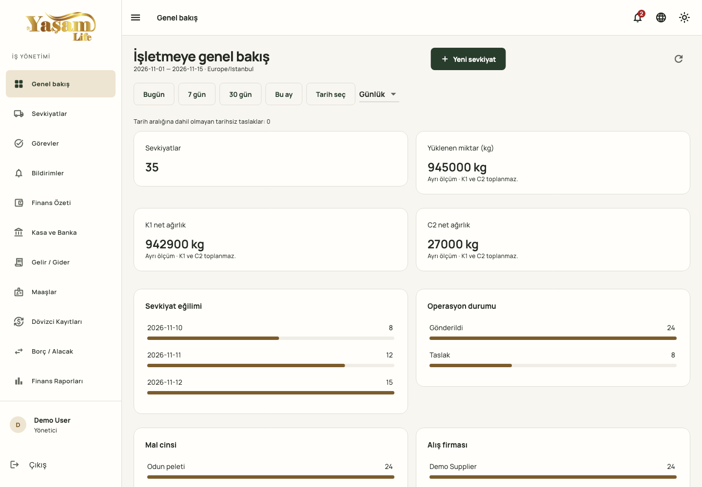
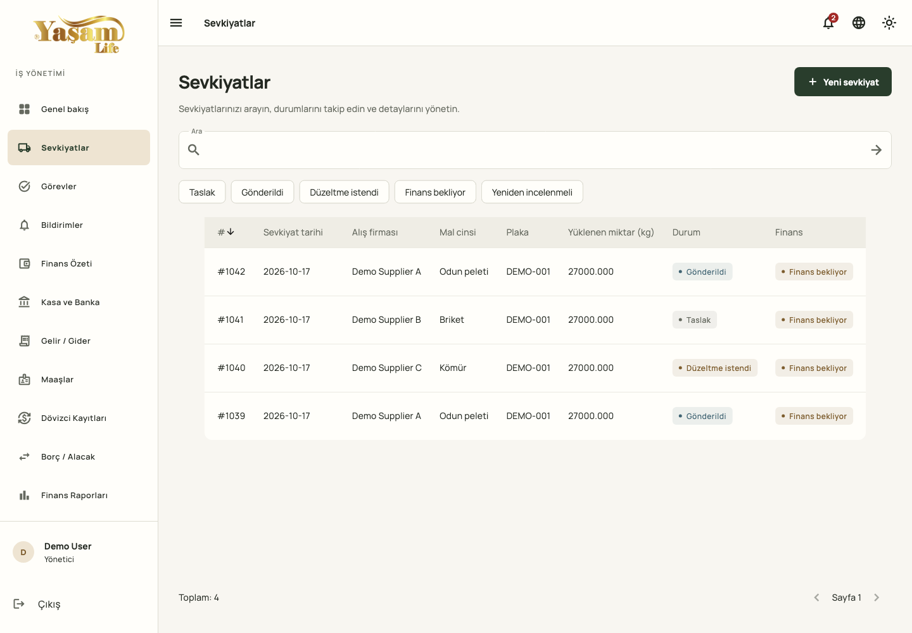
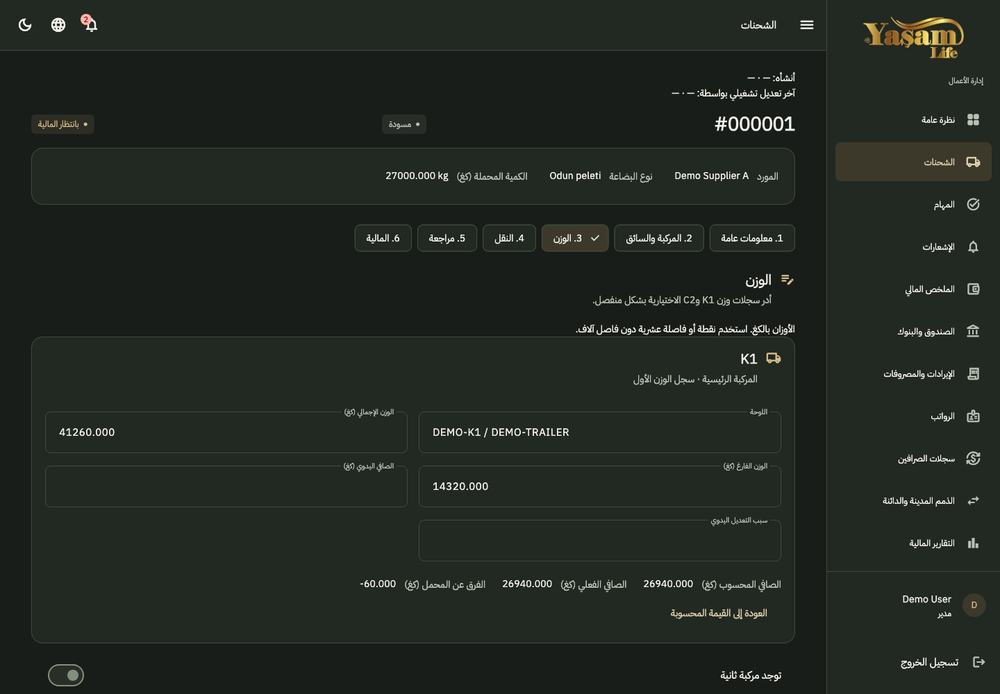
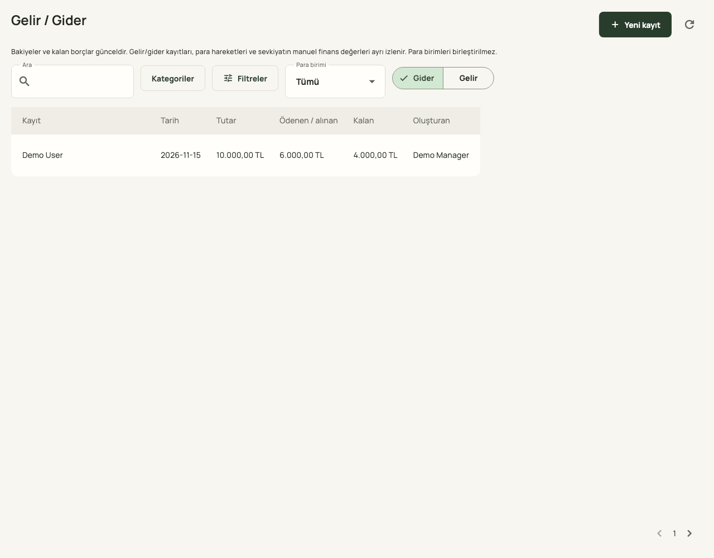

# YaşamLife ERP system — Proje Tanıtımı

[English](README.md) · [Türkçe](README.tr.md) · [العربية](README.ar.md)

**Müşteri projesi · AZİZ TÜRKMEN · Ekim–Kasım 2026; proje sahibinin ay düzeyinde verdiği tarihlerdir. Kesin yayına çıkış ve tamamlanma günleri belgelenmemiştir.**

Sevkiyatları, K1/C2 tartımını, ekip görevlerini ve yönetici muhasebesini Türkçe ve Arapça arayüzlerde birleştiren, masaüstü odaklı ERP uygulaması.

Proje sahibinin beyanına göre CANLI; dağıtım durumu platforma göre değişir.

*S01 — Yük, K1 ve C2 ölçülerini ayrı gösteren masaüstü genel bakışı; örnek veriler.*

Operasyon ekranları gerçek Flutter arayüzünde oluşturulmuş kurgusal örnek veriler içerir. Üretim kaydı, iş sonucu veya fiziksel cihaz görüntüsü değildir. Giriş ekranı, alanları boş olan canlı genel sayfadan alınmıştır.

## Müşteri açısından

Aynı sevkiyatı ekibin ortak görünümüne açarken düzenleme sorumluluğunu ve özel finans bilgilerini korumak; tartım, borç/alacak kaydı ve gerçekleşen ödemeyi birbirinden ayırmak.

Rol ve kayıt durumuna göre çalışan akışları, ortak Flutter arayüzü ve borç/alacak ile ödemeyi ayıran muhasebe modeli. Türkçe ve Arapça düzenler aynı operasyon akışlarını destekler.

- Ortak sevkiyat bilgisi — Durum ve sorumluluk bilgileriyle aynı kayıtları arayın; çalışanların düzenleme sınırları korunur.
- Bağımsız tartım aşamaları — Yüklenen miktarı, K1 netini ve isteğe bağlı C2 netini ayrı izleyin; net düzeltmeleri ve farklar açıkça görünür.
- Ekip koordinasyonu — Görev atayın, ilerlemeyi izleyin ve sevkiyata bağlı işleri yorumlar ile uygulama içi bildirimlerle takip edin.
- Borç/alacak ve ödeme ayrımı — Gelir, gider ve maaş tutarını bir kez kaydedin; kısmi ödemeleri ve kalan bakiyeyi ayrı izleyin.
- Para birimine göre pozisyonlar — Hesap ve dövizci bakiyelerini para birimi bazında görün; anlaşmanın iki para hareketi bağımsız kalır.
- Türkçe ve Arapça deneyim — Aynı uygulamayı Türkçe veya Arapça kullanın; sağdan sola düzen ve açık/koyu temalar desteklenir.

### İş akışı

1. Sevkiyat taslağını oluşturun; yükü ve aracı tanımlayın.
2. K1 ve gerekiyorsa C2 ölçülerini girin, kaydedin ve gönderin.
3. Görev, yorum ve kontrollü düzeltmelerle takibi sürdürün.
4. Özel sevkiyat finansını inceleyin; muhasebe borç/alacaklarını ayrı kaydedin.
5. Ödemeyi işleyin, kalan tutarı görün ve hataları geçmişi koruyan ters kayıtlarla düzeltin.

## Uygulamadan görünümler

*S02 — Arama, durumlar ve kurgusal tedarikçilerle ortak sevkiyat listesi.*

*S03 — Kurgusal araç bilgileriyle brüt, dara ve net alanlarını gösteren Arapça RTL tartım formu.*

*S05 — Tutar, ödenen ve kalan sütunlarını gösteren gelir/gider ekranı; gerçek mali kayıt içermez.*

- [Örnek öncelikler, son tarihler ve ilerleme durumlarıyla görev listesi.](screenshots/app-tasks-desktop-tr-light.png)
- [Örnek ödeme bakiyeleriyle borç/alacak görünümü.](screenshots/app-obligations-desktop-tr-light.png)
- [Flutter testinde oluşturulan dar Arapça sevkiyat görünümü; fiziksel cihaz görüntüsü değildir.](screenshots/app-shipments-narrow-ar-dark.png)
- [Canlı, boş giriş ekranı; kimlik bilgisi girilmedi.](screenshots/web-login-desktop-tr-dark.jpg)

## Platformlar ve dağıtım durumu

Öncelikli deneyim masaüstüdür. Windows ve macOS hedef projeleri bulunur; Android ve iOS aynı Flutter kod tabanını paylaşır. Web uygulamasına tanıtım sayfasından ulaşılır. Önceki raporlarda yerel hata ayıklama/simülatör derlemeleri yer alır; bu incelemede imzalı sürüm veya mağaza kaydı doğrulanmamıştır. 15 Kasım 2026 tarihinde canlı sayfa Windows ZIP paketinin henüz yayımlanmadığını bildiriyordu. Microsoft Store, App Store ve Google Play gelecek dağıtım planlarıdır. Yönetim ekranları ortak uygulamanın içindedir; ayrı yayımlanmış bir yönetici uygulaması yoktur.

## Mühendislik açısından

Ortak arayüz Flutter/Dart ile; durum, gezinme ve iletişim ise Riverpod, GoRouter ve HTTP ile kurulur. Arka uç PHP ve MySQL uyumlu ilişkisel depolama kullanır. Atomik sevkiyat düzenlemesi, kesin ondalık aritmetik, açık inceleme durumları ve ters kayda dayalı mali düzeltmeler iş kurallarını yansıtır. Tekrar deneme yönetimi aynı muhasebe işleminin bilinçsizce çoğaltılmasını önlemeye yöneliktir. Bunlar incelenen uygulama kararlarıdır; güvenlik sertifikası, sınırsız ölçek veya her üretim akışının doğrulandığı anlamına gelmez.

## Diller ve kullanım deneyimi

Uygulama Türkçe ve Arapçayı; sağdan sola düzeni, açık/koyu/sistem temalarını ve masaüstünden dar ekrana uyarlanan görünümleri destekler. Bu tanıtım İngilizce, Türkçe ve Arapçadır. İngilizce uygulama dili olarak uygulanmamıştır. Düzen testleri, tam erişilebilirlik veya fiziksel cihaz kabulü iddiası değildir.

## Proje bilgileri

Ideabat üzerinden sunulan müşteri projesidir. İncelenen teslim kapsamı uygulama, API, veri modeli ve destekleyici tanıtım sayfasını içerir. Ekip üyelerinin ayrı ayrı sorumlulukları ve sözleşmedeki fikrî hak dağılımı bağımsız olarak belgelenmemiştir; münhasır geliştiricilik veya mülkiyet iddiasında bulunulmaz.

Doğrulanan çıktı, uygulanmış operasyon ve temel muhasebe yetenekleridir. Proje sahibi ürünün canlı olduğunu belirtmiştir. Ölçülmüş iş iyileştirmesi, kullanım sayısı, önce/sonra araştırması veya müşteri görüşü bulunmamaktadır.

Uygulama Türkçe ve Arapçadır; İngilizce arayüz uygulanmamıştır. Otomatik kâr hesabı, belge yükleme, banka/canlı kur entegrasyonu, yasal bordro ve mobil dosya paylaşımı doğrulanan teslim kapsamında değildir. İmzalı yerel dağıtım veya mağaza yayını doğrulanmamıştır. 15 Kasım 2026 tarihinde canlı sayfada Windows ZIP paketi henüz yayımlanmamış görünüyordu.

## Resmî proje bağlantısı

[YaşamLife’ı keşfedin](https://app.yasamlife.com/) — tanıtım sayfası 15 Kasım 2026 tarihinde canlı olarak doğrulandı. Gerçek indirme durumunu buradan kontrol edin.

## Planlanan Ideabat sayfaları

**Portfolyo — planlandı — henüz yayımlanmadı**

[English](https://ideabat.com/portfolio/yasamlife-erp/) · [Türkçe](https://ideabat.com/tr/portfolio/yasamlife-erp/) · [العربية](https://ideabat.com/ar/portfolio/yasamlife-erp/)

**Vaka çalışması — planlandı — henüz yayımlanmadı**

[English](https://ideabat.com/case-study/yasamlife-shipment-accounting-workflows/) · [Türkçe](https://ideabat.com/tr/case-study/yasamlife-shipment-accounting-workflows/) · [العربية](https://ideabat.com/ar/case-study/yasamlife-shipment-accounting-workflows/)

## Mülkiyet ve teknik inceleme

Bu depo, uygulamanın kaynak kodu yayını değil; dokümantasyon ve yayın izni kapsamındaki görselleri içerir. Projenin Ideabat üzerinden sunulması müşterinin mülkiyetini devretmez. İşe alım, iş birliği veya teknik inceleme talepleri için Ideabat üzerinden Ragıp Mullamusa ile iletişime geçin. Müşteriye ait kaynak koda erişim, proje sahibinin önceden iznini ve geçerli gizlilik yükümlülüklerine uyulmasını gerektirir. Talepler ayrı ayrı değerlendirilir; kaynak erişimi garanti edilmez. Bu tanıtım herhangi bir yazılım lisansı veya yeniden dağıtım izni vermez.

Ragıp Mullamusa, [Ideabat](https://ideabat.com/) kurucusudur. İlgili mühendislik, işe alım veya iş birliği talepleri için [iletişim sayfasını](https://ideabat.com/contact-us/) kullanabilir ya da [info@ideabat.com](mailto:info@ideabat.com) adresine yazabilirsiniz.
